# Carta Estructurada del Sistema

Este documento contiene la **Carta Estructurada** del sistema actual (**Repositorio de Trabajos e Investigación de IUTEPAL**), diseñada utilizando como referencia técnica el modelo del sistema **S.A.M.E.D** provisto en la imagen de referencia.

---

## 1. Carta Estructurada de Referencia: S.A.M.E.D

A continuación se representa de forma digitalizada la estructura exacta del sistema **S.A.M.E.D** mostrada en la imagen adjunta:

```mermaid
graph TD
    SAMED["S.A.M.E.D"]
    
    SAMED --> Usuarios
    SAMED --> Salas["salas"]
    SAMED --> Clientes
    SAMED --> Libros
    SAMED --> Mantenimiento
    SAMED --> Ayuda
    SAMED --> Reportes
    SAMED --> Salir
    
    Usuarios --> NuevoUsuario["Nuevo Usuario"]
    Usuarios --> CambiarNombre["Cambiar nombre"]
    
    Salas --> VerSalas["Ver"]
    Salas --> AlquilarSalas["Alquilar"]
    Salas --> ReservarSalas["Reservar"]
    
    Clientes --> NuevoCliente["Nuevo Cliente"]
    Clientes --> VerCliente["Ver Cliente"]
    
    Libros --> VerLibros["Ver"]
    Libros --> ReservarLibro["Rerservar libro"]
    
    Mantenimiento --> CambiarClave["Cambiar clave"]
    Mantenimiento --> Respaldo["Respaldo"]
    
    Ayuda --> AcercaDe["Acerca De"]
    
    Reportes --> VerReportes["Ver Reportes"]
    
    Salir --> CerrarSesion["Cerrar Sesión"]
    
    %% Estilos estéticos
    style SAMED fill:#1E293B,stroke:#38BDF8,stroke-width:2px,color:#FFF
    style Usuarios fill:#334155,stroke:#475569,stroke-width:1px,color:#FFF
    style Salas fill:#334155,stroke:#475569,stroke-width:1px,color:#FFF
    style Clientes fill:#334155,stroke:#475569,stroke-width:1px,color:#FFF
    style Libros fill:#334155,stroke:#475569,stroke-width:1px,color:#FFF
    style Mantenimiento fill:#334155,stroke:#475569,stroke-width:1px,color:#FFF
    style Ayuda fill:#334155,stroke:#475569,stroke-width:1px,color:#FFF
    style Reportes fill:#334155,stroke:#475569,stroke-width:1px,color:#FFF
    style Salir fill:#334155,stroke:#475569,stroke-width:1px,color:#FFF
```

---

## 2. Carta Estructurada del Sistema Actual: Repositorio IUTEPAL

Siguiendo el mismo patrón arquitectónico, se ha estructurado el sistema de gestión de trabajos del **IUTEPAL**. Este mapa refleja con precisión los módulos implementados en la aplicación (basados en los archivos `Index.html`, `menu.html`, `registro.html` y `server.js`):

```mermaid
graph TD
    IUTEPAL["REPOSITORIO IUTEPAL"]
    
    IUTEPAL --> Usuarios
    IUTEPAL --> Documentos
    IUTEPAL --> Filtros
    IUTEPAL --> Lineas["Líneas de Inv."]
    IUTEPAL --> Mantenimiento
    IUTEPAL --> Ayuda
    IUTEPAL --> Reportes
    IUTEPAL --> Salir
    
    Usuarios --> IniciarSesion["Iniciar Sesión"]
    Usuarios --> Registrarse["Registrarse"]
    
    Documentos --> VerDocs["Ver / Visualizar"]
    Documentos --> AddDoc["Añadir (Admin)"]
    Documentos --> EditDoc["Editar (Admin)"]
    Documentos --> DelDoc["Eliminar (Admin)"]
    
    Filtros --> PorCarrera["Por Carrera"]
    Filtros --> PorAno["Por Año"]
    Filtros --> PorTipo["Por Tipo"]
    Filtros --> BusquedaTexto["Por Texto"]
    
    Lineas --> VerLineasPdf["Ver PDF Líneas"]
    
    Mantenimiento --> CambiarClave["Cambiar Clave (Admin)"]
    
    Ayuda --> AcercaDe["Acerca De"]
    
    Reportes --> VerReportes["Ver Reportes (Admin)"]
    
    Salir --> CerrarSesion["Cerrar Sesión"]
    
    %% Estilos estéticos
    style IUTEPAL fill:#1E3A8A,stroke:#F59E0B,stroke-width:2px,color:#FFF
    style Usuarios fill:#1E293B,stroke:#3B82F6,stroke-width:1px,color:#FFF
    style Documentos fill:#1E293B,stroke:#3B82F6,stroke-width:1px,color:#FFF
    style Filtros fill:#1E293B,stroke:#3B82F6,stroke-width:1px,color:#FFF
    style Lineas fill:#1E293B,stroke:#3B82F6,stroke-width:1px,color:#FFF
    style Mantenimiento fill:#1E293B,stroke:#3B82F6,stroke-width:1px,color:#FFF
    style Ayuda fill:#1E293B,stroke:#3B82F6,stroke-width:1px,color:#FFF
    style Reportes fill:#1E293B,stroke:#3B82F6,stroke-width:1px,color:#FFF
    style Salir fill:#1E293B,stroke:#3B82F6,stroke-width:1px,color:#FFF
```

---

## 3. Tabla de Equivalencias e Implementación

Para asegurar que la estructura esté alineada, aquí se muestra cómo se mapea el diseño de la referencia con el sistema real:

| Módulo Referencia (S.A.M.E.D) | Módulo Real (IUTEPAL) | Funcionalidades de la Implementación Real |
| :--- | :--- | :--- |
| **Usuarios** | **Usuarios** | Permite el registro de nuevos usuarios (`registro.html` / `/register`) y el inicio de sesión (`Index.html` / `/login-guest` / `/login-admin`). |
| **salas** y **Libros** | **Documentos** | Se unifica en la gestión de trabajos de grado, presentaciones y resúmenes. Permite ver documentos, añadir (`/addTrabajo` / `/upload`), editar (`/updateTrabajo`) y eliminar (`/deleteTrabajo`). |
| **Clientes** | **Filtros** | Se enfoca en la navegación de los usuarios, permitiendo filtrar por Carreras (Informática, Administración, Producción, etc.), por Año, por Tipo de Documento y búsqueda libre por texto. |
| *Nuevo Módulo* | **Líneas de Inv.** | Módulo específico para visualizar el PDF correspondiente a las Líneas de Investigación institucionales. |
| **Mantenimiento** | **Mantenimiento** | Enfocado en la administración de credenciales de seguridad (`/change-password`). |
| **Ayuda** | **Ayuda** | Botón informativo con modal "Acerca de" que detalla créditos del sistema y descripción del mismo. |
| **Reportes** | **Reportes** | Módulo que extrae el reporte detallado de logs de accesos de usuarios y documentos consultados (`/report`). |
| **Salir** | **Salir** | Botón para cerrar sesión activa y borrar sesión del estado de la aplicación. |
