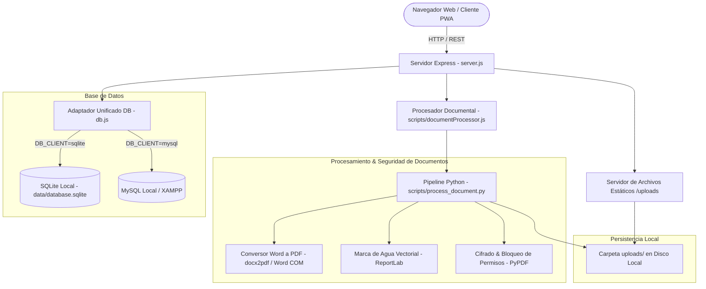
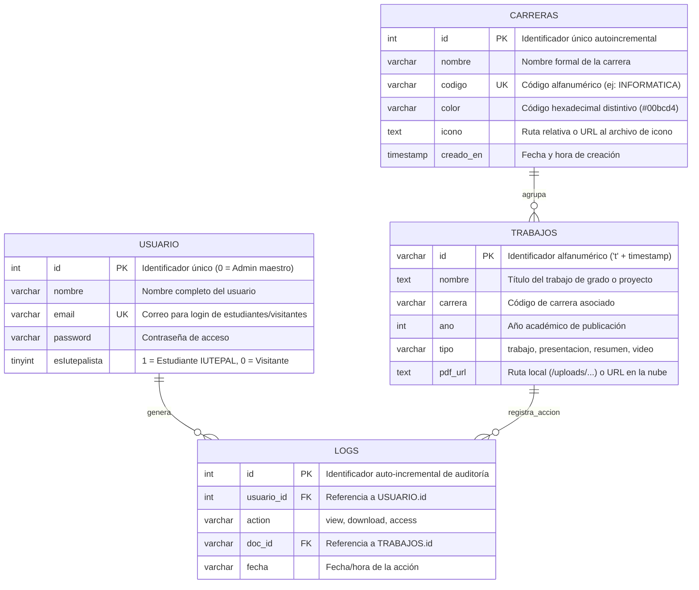

# 📘 Documentación Técnica del Sistema de Gestión Documental IUTEPAL

> **Versión del Sistema:** 2.2.0 (Edición Integral con Seguridad Anti-Plagio y Gestión Dinámica de Carreras)  
> **Fecha de Actualización:** Octubre 2026  
> **Autor / Arquitectura:** Desarrollador Full-Stack Senior & Arquitecto de Software  
> **Institución:** Instituto Universitario de Tecnología Juan Pablo Pérez Alfonzo (IUTEPAL) - Sede Puerto Cabello

---

## 📑 Tabla de Contenidos

1. [Descripción General y Propósito del Sistema](#1-descripción-general-y-propósito-del-sistema)
2. [Arquitectura de Software y Componentes](#2-arquitectura-de-software-y-componentes)
3. [Manual de Instalación y Configuración Paso a Paso](#3-manual-de-instalación-y-configuración-paso-a-paso)
   - [Prerrequisitos](#prerrequisitos)
   - [Clonación e Instalación](#clonación-e-instalación)
   - [Variables de Entorno (.env)](#variables-de-entorno-env)
   - [Ejecución del Servidor](#ejecución-del-servidor)
4. [Estructura y Modelado de la Base de Datos](#4-estructura-y-modelado-de-la-base-de-datos)
   - [Diagrama Entidad-Relación Actualizado](#diagrama-entidad-relación-actualizado)
   - [Descripción Detallada de Tablas y Campos](#descripción-detallada-de-tablas-y-campos)
   - [Soporte Dual: SQLite Embebido vs. MySQL Local](#soporte-dual-sqlite-embebido-vs-mysql-local)
5. [Módulo de Almacenamiento y Gestión de Archivos](#5-módulo-de-almacenamiento-y-gestión-de-archivos)
   - [Funcionamiento Local (Disco / Multer)](#funcionamiento-local-disco--multer)
   - [Servicio y Resolución de Rutas Estáticas](#servicio-y-resolución-de-rutas-estáticas)
6. [Módulo de Conversión Word a PDF y Seguridad Anti-Plagio](#6-módulo-de-conversión-word-a-pdf-y-seguridad-anti-plagio)
   - [Conversión Nativa Word (`.docx`, `.doc`) a PDF](#conversión-nativa-word-docx-doc-a-pdf)
   - [Marca de Agua Vectorial Institucional (`reportlab`)](#marca-de-agua-vectorial-institucional-reportlab)
   - [Bloqueo Criptográfico de Permisos contra Plagio (`pypdf`)](#bloqueo-criptográfico-de-permisos-contra-plagio-pypdf)
   - [Tratamiento Retroactivo de Documentos Preexistentes](#tratamiento-retroactivo-de-documentos-preexistentes)
7. [Módulo de Gestión Dinámica de Carreras (CRUD de Especialidades)](#7-módulo-de-gestión-dinámica-de-carreras-crud-de-especialidades)
   - [Persistencia y Modelo de Datos](#persistencia-y-modelo-de-datos)
   - [Interacción en Frontend y Atajos de Administración](#interacción-en-frontend-y-atajos-de-administración)
   - [Modal de Gestión y Previsualización de Iconos](#modal-de-gestión-y-previsualización-de-iconos)
8. [Control de Acceso Basado en Roles (RBAC) y Seguridad en Interfaz](#8-control-de-acceso-basado-en-roles-rbac-y-seguridad-en-interfaz)
   - [Matriz de Roles y Privilegios](#matriz-de-roles-y-privilegios)
   - [Blindaje de Botones Administrativos en CSS y DOM](#blindaje-de-botones-administrativos-en-css-y-dom)
9. [Instrucciones y Procedimiento de Migración](#9-instrucciones-y-procedimiento-de-migración)
   - [Siembra Inicial de Datos (`seed`)](#siembra-inicial-de-datos-seed)
   - [Migración de Cloudinary a Local](#migración-de-cloudinary-a-local)
   - [Migración de Cloudinary a Nueva Cuenta Cloudinary](#migración-de-cloudinary-a-nueva-cuenta-cloudinary)
   - [Aplicación de Consultas SQL Masivas](#aplicación-de-consultas-sql-masivas)
10. [Referencia Completa de la API REST](#10-referencia-completa-de-la-api-rest)
11. [Mantenimiento, Respaldos y Buenas Prácticas](#11-mantenimiento-respaldos-y-buenas-prácticas)

---

## 1. Descripción General y Propósito del Sistema

El **Sistema de Gestión de Documentos y Trabajos Especiales de Grado (TEG) de IUTEPAL** es una plataforma web desarrollada para catalogar, almacenar, auditar y difundir la producción académica e investigativa generada en la institución. 

### Objetivos Clave de la Arquitectura Actual
- **Independencia Tecnológica Total:** Capaz de operar de forma 100% autosuficiente en redes locales (LAN/Intranet) o servidores institucionales sin requerir conexión continua a internet ni servicios en la nube de terceros.
- **Portabilidad Inmediata (Zero-Config):** Soporte dual de base de datos con **SQLite embebido** por defecto y compatibilidad plena con **MySQL / MariaDB** (XAMPP / Docker / Clever Cloud).
- **Protección Integral Anti-Plagio:** Conversión automática de documentos de Word a PDF protegidos, aplicación de marcas de agua diagonales y encabezados institucionales (`IUTEPAL PUERTO CABELLO`), y cifrado de permisos para prohibir la copia, extracción de texto y modificación de documentos académicos.
- **Administración Parametrizable:** Las especialidades o carreras académicas no están fijas en código duro; ahora se gestionan de manera 100% dinámica desde la base de datos (creación, edición de colores, subida de iconos y eliminación).
- **Seguridad y Control de Roles Estricto:** Diferenciación operativa nítida entre Administradores, Estudiantes Iutepalistas y Visitantes, garantizando que ninguna acción administrativa sea accesible ni visible en modo usuario.

---

## 2. Arquitectura de Software y Componentes

El sistema sigue una arquitectura desacoplada en capas:



### Componentes Clave del Repositorio

- **`server.js`:** Núcleo de la API REST. Configura middlewares, subida de archivos vía Multer, endpoints de autenticación, CRUD de trabajos, CRUD de carreras, auditoría y despacho estático.
- **`db.js`:** Capa de abstracción de datos agnóstica. Conmuta limpiamente entre SQLite (nativo con modo WAL) y MySQL (usando pool de conexiones).
- **`scripts/documentProcessor.js` & `scripts/process_document.py`:** Pipeline industrial de procesamiento documental. Intercepta las cargas de archivos, convierte documentos Word (`.docx`, `.doc`) a PDF nativo, inyecta la marca de agua vectorial `IUTEPAL PUERTO CABELLO` y cifra los permisos de copia/modificación.
- **`scripts/watermark_existing_uploads.py`:** Utilidad CLI de procesamiento por lotes que aplicó la marca de agua y el bloqueo de permisos a todo el histórico preexistente de archivos PDF.
- **`uploads/`:** Almacén persistente local para los documentos académicos procesados.
- **`uploads/backup_original_pdfs/`:** Directorio de respaldo con las copias originales inalteradas previas al procesamiento de seguridad.
- **`STRUCTURE/CSS/menu.css`:** Sistema de diseño institucional, animaciones de tarjetas y reglas estrictas de ocultamiento administrativo (`.admin-only-btn`).
- **`STRUCTURE/SCRIPTS/menu.js`:** Controlador del catálogo: renderizado reactivo, paginación, filtros multicriterio, modales de gestión, validación de archivos y control de sesión.

---

## 3. Manual de Instalación y Configuración Paso a Paso

### Prerrequisitos

- **Node.js:** Versión 18.x o superior (Recomendado v20.x o v22.x LTS).
- **NPM:** Versión 9.x o superior.
- **Python:** Versión 3.10 o superior (Requerido para el pipeline de seguridad y conversión).
- **Bibliotecas Python:**
  ```bash
  pip install pypdf reportlab docx2pdf
  ```
- **Microsoft Word (Opcional pero recomendado en Windows):** Requerido por `docx2pdf` para la conversión nativa fiel al 100% de archivos `.docx` y `.doc`.
- *(Opcional)* **MySQL / MariaDB:** Servidor local como XAMPP o MariaDB (solo si se utiliza `DB_CLIENT=mysql`).

---

### Clonación e Instalación

1. **Clonar el repositorio e ingresar a la carpeta:**
   ```bash
   git clone <URL_DEL_REPOSITORIO>
   cd CODIGOCOMPARTIDOIUTEPAL
   ```

2. **Instalar dependencias de Node.js:**
   ```bash
   npm install
   ```

3. **Instalar dependencias de Python para procesamiento documental:**
   ```bash
   pip install pypdf reportlab docx2pdf
   ```

---

### Variables de Entorno (`.env`)

Crea o revisa el archivo `.env` en la raíz del proyecto (basado en `.env.example`):

```env
# ==========================================
# CONFIGURACIÓN DEL SERVIDOR
# ==========================================
PORT=3000

# ==========================================
# MODO DE ALMACENAMIENTO DE ARCHIVOS
# 'local'       -> Guarda archivos en uploads/ con protección anti-plagio
# 'cloudinary'  -> Modo híbrido en la nube
# ==========================================
STORAGE_TYPE=local
UPLOAD_DIR=uploads

# ==========================================
# MOTOR DE BASE DE DATOS
# 'sqlite' -> Base de datos local embebida (Recomendado)
# 'mysql'  -> Conexión a MySQL/MariaDB (XAMPP, Clever Cloud, etc.)
# ==========================================
DB_CLIENT=sqlite

# Ruta para SQLite (archivo local)
SQLITE_DB_PATH=./data/database.sqlite

# Configuración para MySQL Local (si DB_CLIENT=mysql)
DB_HOST=localhost
DB_PORT=3306
DB_USER=root
DB_PASSWORD=
DB_NAME=document_upload

# Límite de conexiones para evitar saturación en hostings compartidos
MYSQL_CONNECTION_LIMIT=3
```

---

### Ejecución del Servidor

```bash
# Iniciar en modo producción
npm start

# O iniciar en modo desarrollo (si nodemon está disponible)
npm run dev
```
Acceso en el navegador: [http://localhost:3000](http://localhost:3000)

---

## 4. Estructura y Modelado de la Base de Datos

### Diagrama Entidad-Relación Actualizado



---

### Descripción Detallada de Tablas y Campos

#### 1. Tabla `carreras` *(Nueva)*
Permite la administración dinámica y parametrizada de las escuelas del instituto.

| Campo | Tipo | Nulo | Descripción |
| :--- | :--- | :--- | :--- |
| `id` | INTEGER / INT | NO | Clave primaria autoincremental. |
| `nombre` | VARCHAR(100) | NO | Nombre oficial (ej: `Informática`, `Producción Industrial`). |
| `codigo` | VARCHAR(50) | NO | Identificador único en mayúsculas (ej: `INFORMATICA`). |
| `color` | VARCHAR(20) | SÍ | Código de color institucional en formato Hex (`#00bcd4`). |
| `icono` | TEXT | SÍ | Ruta de la imagen del icono (`STRUCTURE/IMG/...` o subido por el usuario). |
| `creado_en` | TIMESTAMP | SÍ | Fecha de registro automático. |

#### 2. Tabla `usuario`
Gestiona las credenciales y niveles de permiso de acceso a la plataforma.

| Campo | Tipo | Nulo | Descripción |
| :--- | :--- | :--- | :--- |
| `id` | INTEGER / INT | NO | Clave primaria. El ID `0` está reservado para el Administrador maestro. |
| `nombre` | VARCHAR(100) | NO | Nombre y apellido del usuario registrado. |
| `email` | VARCHAR(100) | NO | Correo electrónico único utilizado para autenticación de estudiantes. |
| `password` | VARCHAR(255) | NO | Contraseña de acceso. |
| `esIutepalista` | TINYINT(1) | SÍ | `1` = Estudiante IUTEPAL, `0` = Público general / visitante. |

#### 3. Tabla `trabajos`
Catálogo central de la producción académica.

| Campo | Tipo | Nulo | Descripción |
| :--- | :--- | :--- | :--- |
| `id` | VARCHAR(50) | NO | Clave primaria alfanumérica (ej: `t1773283912947`). |
| `nombre` | TEXT | SÍ | Título completo del Trabajo Especial de Grado o proyecto. |
| `carrera` | VARCHAR(50) | SÍ | Código de carrera correspondiente a `carreras.codigo`. |
| `ano` | INTEGER | SÍ | Año de defensa o presentación (ej: `2024`). |
| `tipo` | VARCHAR(20) | SÍ | Categoría: `trabajo` (Tesis), `presentacion` (Diapositivas), `resumen` (Hoja de resumen). |
| `pdf_url` | TEXT | SÍ | Ruta interna protegida `/uploads/archivo.pdf`. |

#### 4. Tabla `logs`
Tabla de auditoría para reportes de actividad, visualizaciones y descargas.

| Campo | Tipo | Nulo | Descripción |
| :--- | :--- | :--- | :--- |
| `id` | INTEGER / INT | NO | Clave primaria auto-incremental. |
| `usuario_id` | INT | NO | Clave foránea referenciando a `usuario.id`. |
| `action` | VARCHAR(50) | NO | `access` (inicio de sesión), `view` (visualización), `download` (descarga). |
| `doc_id` | VARCHAR(50) | SÍ | Clave foránea referenciando a `trabajos.id`. |
| `fecha` | VARCHAR(100) | NO | Estampa de tiempo legible o en formato ISO. |

---

## 5. Módulo de Almacenamiento y Gestión de Archivos

### Funcionamiento Local (Disco / Multer)

1. **Recepción Multi-Formato:**
   El middleware Multer está configurado con `fileFilter` para recibir archivos `.pdf`, `.docx` y `.doc`, verificando tanto la extensión como los tipos MIME (`application/pdf`, `application/vnd.openxmlformats-officedocument.wordprocessingml.document`, `application/msword`).

2. **Almacenamiento Directo en Disco:**
   Los archivos se guardan inicialmente en la carpeta física `uploads/` con nombres normalizados y sufijos únicos temporales para evitar colisiones:
   ```javascript
   const localDiskStorage = multer.diskStorage({
     destination: (req, file, cb) => cb(null, uploadDir),
     filename: (req, file, cb) => {
       const ext = path.extname(file.originalname);
       const base = path.basename(file.originalname, ext).replace(/[^a-zA-Z0-9_-]/g, '_');
       const uniqueSuffix = Date.now() + '-' + Math.round(Math.random() * 1E6);
       cb(null, `${base}_${uniqueSuffix}${ext}`);
     }
   });
   ```

3. **Limpieza Automatizada al Eliminar:**
   Al llamar a `DELETE /deleteTrabajo/:id`, el servidor recupera la ruta del archivo y ejecuta `fs.unlinkSync` sobre el archivo físico en `uploads/`, evitando la acumulación de archivos huérfanos.

---

## 6. Módulo de Conversión Word a PDF y Seguridad Anti-Plagio

Para garantizar la protección de la propiedad intelectual de las investigaciones del IUTEPAL, el sistema incorpora un pipeline automatizado implementado en [`scripts/documentProcessor.js`](scripts/documentProcessor.js) y [`scripts/process_document.py`](scripts/process_document.py).

```
Archivo Subido (.docx, .doc, .pdf)
         │
         ▼
[ Conversión Word a PDF ] (vía docx2pdf / MS Word COM en Windows)
         │
         ▼
[ Inyección de Marca de Agua ] (vía ReportLab en memoria)
   • Encabezado: "INSTITUTO UNIVERSITARIO DE TECNOLOGÍA JUAN PABLO PÉREZ ALFONZO"
   • Marca Central Diagonal: "IUTEPAL PUERTO CABELLO" (Gris semitransparente)
   • Pie de Página: "REPOSITORIO DIGITAL ACADÉMICO - DOCUMENTO PROTEGIDO"
         │
         ▼
[ Cifrado Criptográfico de Permisos ] (vía PyPDF)
   • Contraseña de Usuario: "" (Lectura libre sin contraseñas)
   • Contraseña de Propietario: Clave aleatoria de 32 bytes
   • Permisos Habilitados: PRINT | PRINT_TO_REPRESENTATION (Impresión)
   • Permisos Bloqueados: EXTRACT | COPY | MODIFY | ANNOTATIONS | FORM_FILL
         │
         ▼
PDF Final Protegido en uploads/
```

### Conversión Nativa Word (`.docx`, `.doc`) a PDF
Cuando el usuario sube un archivo de Microsoft Word, el procesador detecta la extensión e invoca `docx2pdf`. Al ejecutarse en el servidor Windows del IUTEPAL, aprovecha el motor COM nativo de Microsoft Word, lo que produce una conversión con exactitud tipográfica, diagramación de tablas y resolución gráfica al 100%.

### Marca de Agua Vectorial Institucional (`reportlab`)
Utilizando `reportlab.pdfgen.canvas`, se genera una capa vectorial superpuesta en cada página que incluye:
- **Encabezado superior:** Nombre oficial de la institución.
- **Marca diagonal central:** La leyenda `IUTEPAL PUERTO CABELLO` rotada a 45° en escala proporcional al tamaño de la página, en color gris claro (`#555555`) con opacidad al 22% (`fillAlpha=0.22`), visible tanto en visualizadores web como en impresiones físicas.
- **Pie de página inferior:** Identificador de documento protegido.

### Bloqueo Criptográfico de Permisos contra Plagio (`pypdf`)
El documento se encripta con el estándar PDF utilizando una clave de propietario secreta. La contraseña de lectura se deja vacía (`""`) para que los estudiantes e investigadores puedan abrir y leer el documento de inmediato sin ingresar ninguna clave.

Sin embargo, los permisos quedan restringidos a nivel binario mediante bitmasks:
- ❌ **Copia de texto bloqueada:** Impide seleccionar y copiar bloques de texto (`Ctrl+C`) en visores estándar (Adobe Acrobat, Foxit, Nitro).
- ❌ **Modificación de contenido bloqueada:** Impide editar el texto, alterar páginas o extraer imágenes.
- ❌ **Extracción de anotaciones bloqueada.**
- ✔️ **Impresión en alta calidad habilitada:** Permite a los docentes e investigadores imprimir copias físicas cuando sea necesario.

### Tratamiento Retroactivo de Documentos Preexistentes
Mediante el script [`scripts/watermark_existing_uploads.py`](scripts/watermark_existing_uploads.py), se procesaron los 26 archivos PDF existentes en la carpeta `uploads/`. Se realizó una copia de seguridad en `uploads/backup_original_pdfs/` y todos los archivos fueron convertidos al nuevo formato protegido con 0 errores.

---

## 7. Módulo de Gestión Dinámica de Carreras (CRUD de Especialidades)

### Persistencia y Modelo de Datos
La información de las especialidades se almacena en la tabla `carreras`. Esto permite añadir nuevas carreras (ej: *Enfermería*, *Mercadeo*, *Diseño Gráfico*) o editar las existentes sin modificar código fuente ni reiniciar el servidor.

### Interacción en Frontend y Atajos de Administración
- **Carga Asíncrona:** La función `loadCarreras()` consulta `/carreras` y renderiza dinámicamente los botones en la barra lateral (`#carreraButtonsContainer`).
- **Atajo de Clic Derecho:** Los administradores pueden hacer **clic derecho** sobre cualquier botón de carrera para abrir automáticamente el modal de edición con los datos precargados de esa carrera.
- **Normalización Óptica de Iconos:** Todos los iconos PNG oficiales de las carreras fueron procesados para tener un área visual uniforme de 410px centrada en un lienzo de 512×512, garantizando coherencia estética en la barra lateral.

### Modal de Gestión y Previsualización de Iconos
El modal `#addCarreraModal` ofrece:
- Selector de modo: Añadir nueva carrera o seleccionar una existente para modificar.
- Entrada de nombre oficial y código alfanumérico opcional (se genera automáticamente a partir del nombre si se omite).
- Selector interactivo de color con vista previa hexadecimal.
- Carga de archivo de icono con previsualización en miniatura.
- Botón de eliminación seguro con mini-modal de confirmación (`#deleteCarreraModal`).

---

## 8. Control de Acceso Basado en Roles (RBAC) y Seguridad en Interfaz

### Matriz de Roles y Privilegios

| Función / Módulo | Administrador (`admin=true`) | Estudiante IUTEPAL (`esIutepalista=true`) | Visitante / Público General |
| :--- | :---: | :---: | :---: |
| Consultar catálogo y búsqueda | ✔️ | ✔️ | ✔️ |
| Filtrar por año y carrera | ✔️ | ✔️ | ✔️ |
| Visualizar Trabajos de Grado y Presentaciones | ✔️ | ✔️ | ✔️ |
| Visualizar Hojas de Resumen | ✔️ | ✔️ | ❌ |
| Descargar archivos académicos | ✔️ | ✔️ | ✔️ |
| Visualizar Líneas de Investigación | ✔️ | ✔️ | ✔️ |
| Cambiar contraseña propia | ✔️ | ✔️ | ✔️ |
| **Añadir nuevo trabajo (`#addTrabajoBtn`)** | ✔️ | ❌ | ❌ |
| **Generar reporte de auditoría (`#elaborarReporteBtn`)** | ✔️ | ❌ | ❌ |
| **Gestionar carreras (`#addCarreraBtn`)** | ✔️ | ❌ | ❌ |
| **Editar documentos (`.edit-btn`)** | ✔️ | ❌ | ❌ |
| **Eliminar documentos (`.delete-btn`)** | ✔️ | ❌ | ❌ |
| **Administrar credenciales de otros usuarios** | ✔️ | ❌ | ❌ |

### Blindaje de Botones Administrativos en CSS y DOM

Para erradicar la posibilidad de que los botones administrativos se muestren en sesiones de usuarios regulares o visitantes:

1. **Clase Defensiva `.admin-only-btn` en HTML:**
   Los botones `#addTrabajoBtn`, `#elaborarReporteBtn` y `#addCarreraBtn` poseen de forma nativa la clase `.admin-only-btn` y estilo `display:none;`.

2. **Regla Estricta en CSS (`menu.css`):**
   ```css
   .admin-only-btn,
   body:not(.is-admin) .admin-only-btn,
   body:not(.is-admin) #addTrabajoBtn,
   body:not(.is-admin) #elaborarReporteBtn,
   body:not(.is-admin) #addCarreraBtn {
       display: none !important;
   }

   body.is-admin .admin-only-btn {
       display: inline-flex !important;
   }
   ```
   Esta regla impide que estilos en línea o scripts modifiquen la visualización si el cuerpo del documento no posee la clase `is-admin`.

3. **Sincronización en `menu.js`:**
   Al cargarse el script, se evalúa `isAdmin` y se aplica o remueve `is-admin` de `document.body` antes de cualquier llamada asíncrona, eliminando parpadeos o estados inconsistentes.

---

## 9. Instrucciones y Procedimiento de Migración

### Siembra Inicial de Datos (`seed`)
Puebla de forma idempotente las tablas de usuarios, carreras, trabajos y registros de auditoría:
```bash
npm run seed
```

### Migración de Cloudinary a Local
Descarga los archivos desde Cloudinary a la carpeta física `uploads/` y actualiza la base de datos a rutas locales:
```bash
npm run migrate
```

### Migración de Cloudinary a Nueva Cuenta Cloudinary
```bash
npm run migrate:cloudinary
```

### Aplicación de Consultas SQL Masivas
Al ejecutarse las migraciones, se genera el archivo `scripts/update_urls_local.sql` con las sentencias `UPDATE` transaccionales para ejecución directa en consolas SQL.

---

## 10. Referencia Completa de la API REST

| Método | Endpoint | Rol Mínimo | Descripción | Payload / Form-Data | Respuesta Exitosa |
| :--- | :--- | :---: | :--- | :--- | :--- |
| `POST` | `/upload` | Admin | Sube, convierte a PDF y protege documento | `documento` (File: PDF, DOCX, DOC) | `{ "message": "...", "url": "/uploads/..." }` |
| `GET` | `/trabajos` | Público | Lista todos los trabajos catalogados | Ninguno | `[ { "id", "nombre", "pdf_url", ... } ]` |
| `POST` | `/addTrabajo` | Admin | Registra un nuevo trabajo académico | JSON: `{ "nombre", "carrera", "ano", "tipo", "pdf_url" }` | `{ "success": true, "id": "..." }` |
| `POST` | `/updateTrabajo` | Admin | Modifica metadatos o archivo de un trabajo | JSON: `{ "id", "nombre", "carrera", "ano", "tipo", "pdf_url" }` | `{ "success": true, "message": "..." }` |
| `DELETE` | `/deleteTrabajo/:id` | Admin | Elimina trabajo y borra archivo en disco | Parámetro URL: `id` | `{ "message": "Trabajo eliminado" }` |
| `GET` | `/carreras` | Público | Obtiene la lista de carreras activas | Ninguno | `[ { "id", "nombre", "codigo", "color", "icono" } ]` |
| `POST` | `/carreras` | Admin | Registra una nueva carrera académica | Form-Data: `nombre`, `codigo`, `color`, `icono` (File) | `{ "success": true, "id": ... }` |
| `PUT` | `/carreras/:id` | Admin | Actualiza los datos o icono de una carrera | Form-Data: `nombre`, `codigo`, `color`, `icono` (File) | `{ "success": true, "message": "..." }` |
| `DELETE` | `/carreras/:id` | Admin | Elimina una carrera de la base de datos | Parámetro URL: `id` | `{ "success": true, "message": "..." }` |
| `POST` | `/login-admin` | Público | Inicio de sesión de Administrador | JSON: `{ "username", "password" }` | `{ "success": true, "user": { ... } }` |
| `POST` | `/login-guest` | Público | Inicio de sesión de Estudiantes / Visitantes | JSON: `{ "email", "password" }` | `{ "success": true, "user": { ... } }` |
| `POST` | `/register` | Público | Registro de nuevos estudiantes/visitantes | JSON: `{ "nombre", "apellido", "email", "password", "esIutepalista" }` | `{ "success": true, "message": "..." }` |
| `POST` | `/change-password` | Usuario | Cambio de contraseña de la cuenta activa | JSON: `{ "usuario_id", "currentPassword", "newPassword" }` | `{ "success": true, "message": "..." }` |
| `GET` | `/report` | Admin | Datos agregados de auditoría y top vistos | Ninguno | `[ { "usuario_id", "nombre", "action", "fecha", ... } ]` |
| `POST` | `/log-action` | Público | Registra visualizaciones y descargas | JSON: `{ "usuario_id", "action", "doc_id", "fecha" }` | `{ "message": "Acción registrada" }` |

---

## 11. Mantenimiento, Respaldos y Buenas Prácticas

1. **Respaldo de Documentos Locales:**
   Para respaldar el repositorio completo de documentos protegidos y los respaldos originales:
   ```bash
   tar -czvf respaldo_uploads_$(date +%F).tar.gz uploads/
   ```

2. **Respaldo de Base de Datos:**
   - **En SQLite:** Copiar el archivo `data/database.sqlite`.
   - **En MySQL:** Ejecutar `mysqldump -u root -p document_upload > respaldo_bd_$(date +%F).sql`.

3. **Mantenimiento del Entorno Python:**
   Asegúrese de mantener actualizadas las librerías `pypdf` y `reportlab` para asegurar compatibilidad con versiones futuras de visores PDF.

---
*Fin de la Documentación Técnica del Sistema de Gestión Documental IUTEPAL.*
